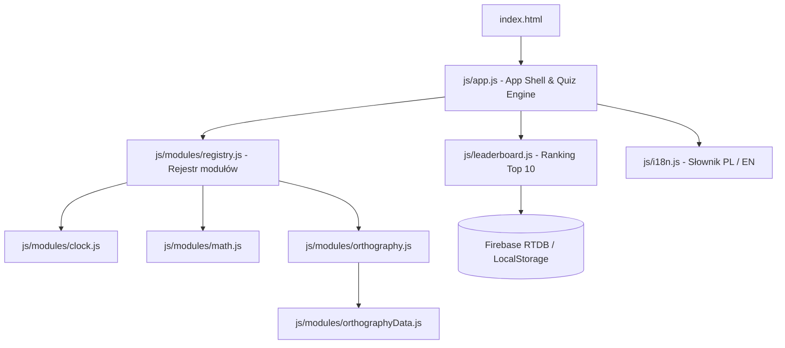

# 🎓 Akademia Bystrzaka (Smart Kids Academy)
### Interaktywna platforma edukacyjna dla klas 1–3 szkoły podstawowej

<p align="center">
  <a href="README.md"><strong>🇵🇱 Wersja polska</strong></a> •
  <a href="README_EN.md">🇬🇧 English version</a>
</p>

<p align="center">
  <a href="https://github.com/phxphoenix/Zegar/actions/workflows/ci.yml"></a>
  <a href="https://phxphoenix.github.io/Zegar/"></a>
  
  
  
  
  <a href="LICENSE"></a>
</p>

> 🚀 **Wypróbuj aplikację na żywo w przeglądarce**: [https://phxphoenix.github.io/Zegar/](https://phxphoenix.github.io/Zegar/)

**Akademia Bystrzaka** to nowoczesna, responsywna aplikacja internetowa wspierająca edukację wczesnoszkolną dzieci w klasach 1–3. Łączy realizację **podstawy programowej MEN** z przyjazną grywalizacją (*edutainment*), oferując wszechstronny trening odczytu czasu, sprawności rachunkowej oraz zasad polskiej pisowni.

---

## 📑 Spis treści
1. [Kluczowe moduły edukacyjne](#-kluczowe-moduły-edukacyjne)
   - [1. Moduł: Zegar (Odczyt czasu)](#1-moduł-zegar-odczyt-czasu)
   - [2. Moduł: Matematyka (Klasy 1–3)](#2-moduł-matematyka-klasy-13)
   - [3. Moduł: Ortografia (Klasy 1–3)](#3-moduł-ortografia-klasy-13)
2. [Grywalizacja i Ranking Top 10](#-grywalizacja-i-ranking-top-10)
   - [Niezależne rankingi per sekcja](#niezależne-rankingi-per-sekcja)
   - [Funkcja „Pora spać” / „Koniec na dziś”](#funkcja-pora-spać--koniec-na-dziś)
   - [Synchronizacja Firebase i LocalStorage](#synchronizacja-firebase-i-localstorage)
3. [Architektura techniczna i wzorce projektowe](#-architektura-techniczna-i-wzorce-projektowe)
   - [Kontrakt modułu edukacyjnego](#kontrakt-modułu-edukacyjnego)
   - [Struktura katalogów](#struktura-katalogów)
4. [Uruchamianie aplikacji](#-uruchamianie-aplikacji)
5. [Komplet testów automatycznych](#-komplet-testów-automatycznych)
6. [Przewodnik dla dewelopera (Rozbudowa)](#-przewodnik-dla-dewelopera-rozbudowa)
7. [English Summary](#-english-summary)

---

## 🌟 Kluczowe moduły edukacyjne

### 1. Moduł: Zegar (Odczyt czasu)
* **Wizualna tarcza analogowa SVG**:
  - 60 precyzyjnych znaczników minutowych oraz 12 dużych, czytelnych cyfr godzinowych.
  - Płynnie animowane wskazówki: godzinowa (niebieska, gruba) oraz minutowa (czerwona, długa).
  - Precyzyjny kąt obrotu wskazówki godzinowej uwzględniający upływ minut (`kąt = (godzina % 12) * 30° + minuty * 0.5°`).
* **Dynamiczny wskaźnik pory dnia**:
  - Kolorystyczna odznaka z ikoną określająca kontekst doby: **Noc** (🌙 22:00–04:59), **Rano** (🌅 05:00–11:59), **Po południu** (☀️ 12:00–17:59), **Wieczorem** (🌆 18:00–21:59).
* **Formaty odpowiedzi do wyboru**:
  - **Cyfrowy 24h**: jednoznaczny format cyfrowy (np. `15:30` vs `03:30`).
  - **Słowny**: naturalny język polski (np. *wpół do czwartej*, *kwadrans po drugiej*, *za 10 min pierwsza*) lub angielski (*half past three*, *quarter past two*).
* **Panel rodzica / nauczyciela (⚙️)**:
  - Możliwość manualnego zadania konkretnej godziny i minut.
  - Generator losowego czasu z krokami 5-minutowymi.

---

### 2. Moduł: Matematyka (Klasy 1–3)
Dostosowany do podstawy programowej edukacji wczesnoszkolnej:
* **Klasa 1**: Dodawanie i odejmowanie w zakresie do 20 (w tym dopełnianie i przekraczanie progu dziesiątkowego), intuicyjny wstęp do mnożenia i dzielenia na małych liczbach (2–5).
* **Klasa 2**: Działania w zakresie do 100, tabliczka mnożenia i dzielenia do 50.
* **Klasa 3**: Działania do 100 oraz setki i dziesiątki do 1000, pełna tabliczka mnożenia i dzielenia do 100.
* **4 podstawowe działania arytmetyczne**: Dodawanie (`➕`), Odejmowanie (`➖`), Mnożenie (`✖️`), Dzielenie (`➗`). Możliwość jednoczesnego wyboru dowolnej kombinacji (min. 1 aktywne).
* **Inteligentny generator zmyłek (*Distractor Engine*)**:
  - Nie generuje przypadkowych liczb – tworzy opcje oparte na typowych błędach dzieci (błędy o ±1, ±2, pomyłki dziesiątek ±10, odwrócenie cyfr jedności przy odejmowaniu z pożyczaniem, sąsiednie wartości z tabliczki mnożenia).
* **Podpowiedzi wizualne na żądanie (*Visual Hints*)**:
  - **Ramki dziesiętne (*Ten-frame*)**: wizualizacja kropek niebieskich i zielonych przy dodawaniu oraz skreśleń `✕` przy odejmowaniu.
  - **Słupki dziesiątek i jedności**: dekompozycja liczb dwucyfrowych na dziesiątki i jedności.
  - **Grupowanie elementów**: wizualizacja mnożenia jako zbioru jednakowych grup oraz dzielenia jako równego podziału na pudełka.

---

### 3. Moduł: Ortografia (Klasy 1–3)
Bogaty słownik edukacyjny (ponad 135 zwalidowanych haseł) obejmujący 3 grupy trudności:
* **Kategorie**:
  - 🅰️ **Ó oraz U** (`u_o`)
  - 🅱️ **RZ oraz Ż** (`rz_z`)
  - 🅲 **CH oraz H** (`ch_h`)
* **Podział według charakteru reguły**:
  - **Oboczności (wyrazy wymienne)**: np. *ó → o* (*stół : stoły*), *rz → r* (*morze : morski*), *ż → g/dz* (*książka : księga*), *ch → sz* (*mucha : muszka*).
  - **Zasady pisowni**: np. *rz po spółgłoskach (b, p, d, t, k, g, w, ch, j)*, przyrostki *-ówka*, *-unek*, czasowniki z końcówką *-uje*.
  - **Wyrazy do zapamiętania i wyjątki**: słówka niewymienne (np. *żaba, córka, herbata*) oraz klasyczne wyjątki (*pszczoła, kształt, skuwka, druh*).
* **3 zróżnicowane tryby gry**:
  - 🧩 **Uzupełnij lukę (*gap*)**: dziecko wskazuje właściwą literę lub dwuznak (np. `st_ł` → `ó`).
  - 📝 **Pełne wyrazy (*word*)**: 4 warianty zapisu tego samego słowa (np. *stół*, *stuł*, *stoł*, *stul*).
  - 🔍 **Bystre oko / Detektyw (*spot*)**: 4 różne wyrazy na ekranie – 3 zawierają celowy błąd ortograficzny, zadaniem gracza jest odnaleźć jedyny poprawny!
* **Wsparcie kontekstowe**:
  - Zdania przykładowe z elementarza z możliwością włączenia/wyłączenia.
  - Emoji skojarzeniowe oraz angielskie tłumaczenia ułatwiające zrozumienie.
  - Podpowiedź z kluczem reguły (🔑) i przystępnym wyjaśnieniem.

---

## 🏆 Grywalizacja i Ranking Top 10

### Niezależne rankingi per sekcja
Każdy dział tematyczny posiada niezależną tabelę Top 10:
- **Zegar**: z odznaką formatu cyfrowego lub słownego.
- **Matematyka**: z odznaką klasy (np. *Kl. 2*) oraz ikonami ćwiczonych działań (np. `➕➖✖️`).
- **Ortografia**: z odznaką klasy (np. *Kl. 1*) oraz ćwiczonych trudności (np. `Ó/U, RZ/Ż`).

### Funkcja „Pora spać” / „Koniec na dziś” (🌙)
Specjalnie zaprojektowany mechanizm wspierający higienę cyfrową i wieczorny rytuał zasypiania:
1. Przycisk **„🌙 Koniec na dziś”** (lub z paska nagłówka **„🌙 Koniec”**) pozwala zakończyć sesję w dowolnej chwili bez utraty wypracowanego wyniku.
2. **Kwalifikacja do Top 10**:
   - Jeżeli bieżący wynik mieści się w czołowej dziesiątce danej sekcji, natychmiast otwiera się okno zapisu imienia z gratulacjami na dobranoc!
3. **Wynik poniżej progu Top 10**:
   - Wyświetla się dedykowany modal wieczorny informujący o osiągniętym wyniku, aktualnym progu 10. miejsca oraz dokładnej liczbie punktów, jakiej zabrakło.
   - Dziecko ma wybór: **„💪 Gram dalej”** (kontynuacja serii) lub **„🌙 Idę spać”** (bezpieczne zakończenie sesji z ciepłym komunikatem pożegnalnym).

### Synchronizacja Firebase i LocalStorage
- **Chmura (Firebase Realtime Database REST API)**: umożliwia rywalizację rodzeństwa lub uczniów na różnych urządzeniach w czasie rzeczywistym.
- **Offline Fallback (LocalStorage)**: w przypadku braku połączenia internetowego aplikacja działa płynnie w trybie lokalnym.
- **Automatyczna migracja danych**: moduł rankingu automatycznie rozpoznaje archiwalne wpisy z wersji v1 i bezstratnie migruje je do nowej struktury per-moduł v2.

---

## 🏛️ Architektura techniczna i wzorce projektowe

Aplikacja została zbudowana w architekturze **Vanilla ES Modules** – nie wymaga żadnego skomplikowanego bundlera (Vite/Webpack) do działania w przeglądarce.



### Kontrakt modułu edukacyjnego
Każdy moduł implementuje jednolity interfejs:
```javascript
export interface EducationalModule {
  id: string;
  mountStage(stageContainer: HTMLElement, lang: string): void;
  mountConfig(configContainer: HTMLElement, lang: string, hooks: object): void;
  generateQuestion(lang: string, randomize?: boolean): { correctAnswer: string; options: string[] };
  refreshLanguage(lang: string): { correctAnswer: string; options: string[] };
  getRankingPayload(): { moduleId: string; mode: string; meta: object };
}
```

### Struktura katalogów
```text
Zegar/
├── index.html                   # Główny szkielet aplikacji HTML5 + Tailwind CSS
├── package.json                 # Konfiguracja projektu i skryptów testowych
├── .gitignore                   # Ignorowane pliki i katalogi (node_modules)
├── README.md                    # Niniejsza dokumentacja
├── js/
│   ├── app.js                   # Rdzeń aplikacji (nawigacja, serie punktowe, modale)
│   ├── i18n.js                  # Pełny słownik dwujęzyczny (PL / EN)
│   ├── leaderboard.js           # Silnik rankingu Top 10, synchronizacja i migracja
│   └── modules/
│       ├── registry.js          # Rejestr modułów edukacyjnych
│       ├── clock.js             # Moduł zegara analogowego SVG i odczytu czasu
│       ├── math.js              # Moduł matematyki klas 1-3 z podpowiedziami
│       ├── orthography.js       # Moduł ortografii (3 tryby quizu, filtry)
│       └── orthographyData.js   # Baza słówek, zdań i reguł ortograficznych
└── tests/
    ├── helpers/
    │   └── dom.js               # Środowisko JSDOM z mockami localStorage i fetch
    ├── app.test.js              # Testy integracyjne powłoki aplikacji
    ├── clock.test.js            # Testy tarczy zegara, kątów i formatów czasu
    ├── i18n.test.js             # Testy kompletności słownika PL/EN
    ├── leaderboard.test.js      # Testy sortowania, kwalifikacji i migracji
    ├── math.test.js             # Testy generatora zadań matematycznych i podpowiedzi
    ├── orthography.test.js      # Testy silnika ortografii i trybów gry
    ├── orthographyData.test.js  # Walidacja integralności bazy słówek
    └── registry.test.js         # Testy rejestru modułów i kontraktu
```

---

## 🚀 Uruchamianie aplikacji

### Wymagania wstępne
- Dowolna nowoczesna przeglądarka internetowa (Chrome, Edge, Firefox, Safari).
- Node.js (wersja >= 18.0.0) – wymagana do uruchamiania testów automatycznych.

### Uruchomienie lokalne
Ponieważ aplikacja korzysta ze standardowych modułów ECMAScript (`type="module"`), należy ją serwować przez dowolny serwer HTTP:

1. **Za pomocą Node.js**:
   ```bash
   npx serve .
   ```
   lub:
   ```bash
   npx http-server .
   ```
2. **Za pomocą Pythona**:
   ```bash
   python -m http.server 8000
   ```
3. **Za pomocą rozszerzenia VS Code**:
   Kliknij prawym przyciskiem myszy na `index.html` i wybierz **Open with Live Server**.

Otwórz w przeglądarce adres: `http://localhost:3000` (lub odpowiedni port).

---

## 🧪 Komplet testów automatycznych

Projekt posiada w 100% zautomatyzowany komplet **63 testów** wykorzystujących natywny test runner Node.js (`node:test`) oraz `jsdom`.

### Uruchomienie wszystkich testów:
```bash
npm test
```
lub bezpośrednio:
```bash
node --test tests/**/*.test.js
```

### Podsumowanie zestawów testowych:

| Plik testowy | Liczba testów | Zakres weryfikacji |
| :--- | :---: | :--- |
| `tests/i18n.test.js` | **7** | Kompletność tłumaczeń PL i EN, parzystość kluczy, dynamiczne formatowanie punktacji i reguł. |
| `tests/orthographyData.test.js` | **6** | Integralność schematu 135+ słówek, unikalność ID, brak zduplikowanych/samozwrotnych zmyłek. |
| `tests/registry.test.js` | **4** | Zgodność zarejestrowanych modułów ze standardowym kontraktem, obsługa fallbacków. |
| `tests/leaderboard.test.js` | **17** | Algorytm sortowania Top 10, kryteria kwalifikacji, migracja pamięci v1 -> v2, fallback offline. |
| `tests/clock.test.js` | **7** | Rysowanie tarczy SVG (60 kresek, 12 liczb), kąty wskazówek, pory dnia, formaty cyfrowy i słowny. |
| `tests/math.test.js` | **7** | Zakresy liczbowe klas 1–3, bezbłędność działań (+, −, ×, ÷), silnik zmyłek, wizualne podpowiedzi. |
| `tests/orthography.test.js` | **8** | Tryby quizu (*gap*, *word*, *spot*), filtry reguł (*explainable*, *memory*), antypowtórzeniowość pytań. |
| `tests/app.test.js` | **7** | Integracja powłoki, przełączanie modułów, seria punktowa, zmiana języka, funkcja „Pora spać”. |
| **ŁĄCZNIE** | **63** | **100% testów zakończonych sukcesem (Pass)** |

---

## 🛠️ Przewodnik dla dewelopera (Rozbudowa)

### 1. Jak dodać nowy moduł przedmiotowy (np. Geometria lub Język angielski)?
1. Utwórz plik modułu w `js/modules/nowyModul.js`.
2. Zaimplementuj standardowy kontrakt:
   ```javascript
   export const newModule = {
     id: 'geometry',
     mountStage(stageContainer, lang) { /* ... */ },
     mountConfig(configContainer, lang, hooks) { /* ... */ },
     generateQuestion(lang, randomize = true) {
       return { correctAnswer: 'Kwadrat', options: ['Kwadrat', 'Trójkąt', 'Koło', 'Romb'] };
     },
     refreshLanguage(lang) { /* ... */ },
     getRankingPayload() {
       return { moduleId: 'geometry', mode: 'shapes', meta: {} };
     }
   };
   ```
3. Zarejestruj moduł w `js/modules/registry.js`:
   ```javascript
   import { newModule } from './nowyModul.js';
   export const MODULES = [clockModule, mathModule, orthographyModule, newModule];
   ```
4. Dodaj tłumaczenia zakładek i pytań w `js/i18n.js` w sekcjach `pl.modules` i `en.modules`.

### 2. Jak dodać nowe słówka do bazy ortograficznej?
Dopisz nowy obiekt do tablicy `ORTHOGRAPHY_WORDS` w pliku `js/modules/orthographyData.js`:
```javascript
{
  id: 'nowe_slowo',
  grade: 2,                        // 1 | 2 | 3
  category: 'u_o',                 // 'u_o' | 'rz_z' | 'ch_h'
  ruleType: 'alternation',         // 'alternation' | 'rule' | 'memory'
  word: 'ogród',
  masked: 'ogr_d',
  target: 'ó',
  wrongWord: 'ogrud',
  distractorWords: ['ogrud', 'ogrod', 'ogrut'],
  letterOptions: ['ó', 'u', 'o', 'a'],
  emoji: '🏡',
  sentence: 'Wiosną w naszym ___ zakwitły kolorowe tulipany.',
  enMeaning: 'garden',
  alternation: 'ó → o',
  hintPl: 'Oboczność <strong>ó → o</strong>: piszemy <strong>ó</strong>, bo wymienia się na <strong>o</strong> (<em>ogr<strong>o</strong>dy</em>).',
  hintEn: 'Alternation <strong>ó → o</strong>: changes to <strong>o</strong> in related word <em>ogr<strong>o</strong>dy</em>.'
}
```
Uruchom `npm test`, aby automatyczna walidacja sprawdziła poprawność nowo dodanego hasła!

---

## 🌍 English Summary

**Akademia Bystrzaka (Smart Kids Academy)** is an interactive educational web app tailored for primary school pupils (Grades 1–3). It provides gamified learning across three core domains:
1. **Clock Reading**: Interactive SVG clock with dynamic hands, time of day indicators (morning, afternoon, evening, night), 24h digital format, and verbal expressions in both Polish and English.
2. **Primary School Math**: Addition, subtraction, multiplication, and division aligned with the curriculum across Grades 1 to 3, supported by realistic distractor generation and on-demand visual hints (ten-frame dot models, place-value decomposition bars, and grouping diagrams).
3. **Polish Spelling & Orthography**: Comprehensive coverage of key Polish digraphs and letter pairs (`ó/u`, `rz/ż`, `ch/h`) across root alternations, rules, and memorized words, featuring three distinct challenge modes: *Fill the Gap*, *Word Selection*, and *Sharp Eye Detective*.
4. **Bedtime & Leaderboards**: Per-module Top 10 rankings with Firebase Realtime Database sync and offline localStorage fallback, complemented by a bedtime early-finish option with threshold tracking.
5. **Testing**: Includes a complete automated test suite of 63 tests built on Node.js native test runner and JSDOM (`npm test`).

---

## 📄 Licencja
Projekt udostępniany na warunkach licencji [MIT](LICENSE).
Może być swobodnie wykorzystywany w szkołach, placówkach oświatowych oraz do nauki w domu!
