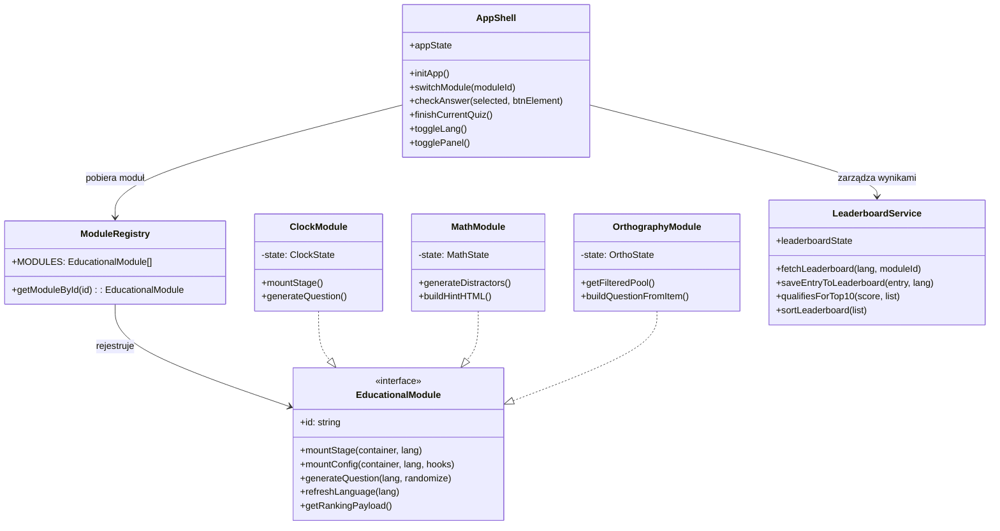
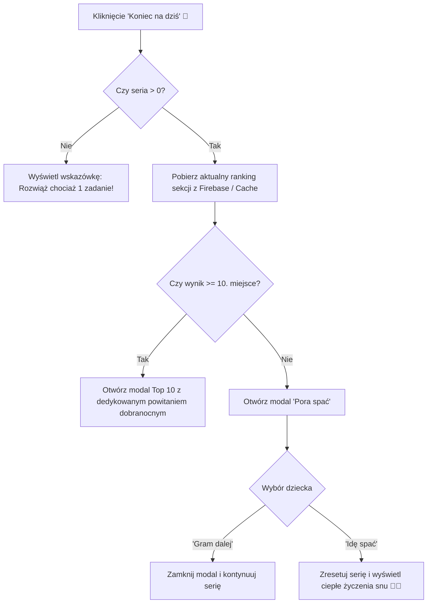

# 🏗️ Architektura Techniczna: Akademia Bystrzaka

Niniejszy dokument opisuje architekturę systemu, przepływ danych, zarządzanie stanem oraz wzorce projektowe zastosowane w aplikacji **Akademia Bystrzaka**.

---

## 1. Zasady projektowe

1. **Zero-build runtime**: Kod źródłowy w warstwie produkcyjnej działa bezpośrednio w przeglądarce za pośrednictwem natywnych modułów ECMAScript (`type="module"`).
2. **Modularny kontrakt (Plugin Architecture)**: Każdy dział wiedzy (Zegar, Matematyka, Ortografia) jest autonomicznym modułem implementującym ujednolicony interfejs.
3. **Izolacja danych i stanów**: Powłoka aplikacji (`app.js`) nie posiada zakodowanej wiedzy domenowej o specyfice zadań; zarządza jedynie uniwersalnymi seriami punktowymi, przełączaniem widoków, językiem oraz interfejsem użytkownika.
4. **Odporność na brak sieci (Offline-First Fallback)**: Wszystkie operacje rankingowe próbują w pierwszej kolejności zsynchronizować stan z chmurą Firebase RTDB, a w razie braku sieci natychmiast korzystają z lokalnej pamięci `localStorage`.

---

## 2. Diagram architektury komponentów



---

## 3. Cykl życia pytania (Quiz Flow)

```mermaid
sequenceDiagram
    autonumber
    actor Gracz as Dziecko / Gracz
    participant Shell as App Shell (app.js)
    participant Mod as Moduł Przedmiotowy
    participant Ranking as Leaderboard (leaderboard.js)

    Gracz->>Shell: Uruchomienie aplikacji lub kliknięcie zakładki
    Shell->>Mod: mountStage() + mountConfig()
    Shell->>Mod: generateQuestion()
    Mod-->>Shell: { correctAnswer, options[4] }
    Shell->>Gracz: Renderuje 4 kafle odpowiedzi

    Gracz->>Shell: Kliknięcie kafelka odpowiedzi
    alt Odpowiedź POPRAWNA
        Shell->>Shell: score = score + 1 (zwiększenie serii)
        Shell->>Gracz: Podświetlenie na zielono (emerald), animacja sukcesu
        Shell->>Mod: generateQuestion() po 1.2s
        Mod-->>Shell: Nowe zadanie
    else Odpowiedź BŁĘDNA
        Shell->>Shell: Poprzedni wynik = score; score = 0
        Shell->>Gracz: Podświetlenie na czerwono (rose), informacja o błędzie
        opt Wynik > 0
            Shell->>Ranking: qualifiesForTop10(poprzedniWynik)
            alt Zakwalifikowano do Top 10
                Shell->>Gracz: Wyświetlenie modala Top 10 z polem na imię
            end
        end
    end
```

---

## 4. Przepływ zakończenia quizu („Pora spać”)

Mechanizm `finishCurrentQuiz()` obsługuje dwa scenariusze:



---

## 5. Model danych

### Wpis w rankingu Top 10
```typescript
interface LeaderboardEntry {
  id: string;               // Unikalny klucz rekordu (timestamp + random hash)
  name: string;             // Imię gracza (maks. 16 znaków)
  score: number;            // Osiągnięta seria punktów (> 0)
  moduleId: string;         // 'clock' | 'math' | 'orthography'
  mode: string;             // np. 'digital' | 'words' | 'math' | 'gap' | 'word' | 'spot'
  meta: {
    grade?: number;         // 1 | 2 | 3
    ops?: string[];         // np. ['add', 'sub']
    categories?: string[];  // np. ['u_o', 'rz_z']
    ruleFilter?: string;    // 'all' | 'explainable' | 'memory'
    customBadge?: string;   // Opcjonalna etykieta tekstowa
  };
  date: string;             // Data zapisu ISO 8601
}
```

### Rekord słownika ortograficznego
```typescript
interface OrthographyWord {
  id: string;               // Unikalny identyfikator
  grade: 1 | 2 | 3;         // Poziom trudności (klasa)
  category: 'u_o' | 'rz_z' | 'ch_h';
  ruleType: 'alternation' | 'rule' | 'memory';
  word: string;             // Poprawny zapis
  masked: string;           // Wyraz z luką '_'
  target: string;           // Właściwa litera lub dwuznak
  wrongWord: string;        // Najczęstszy błąd fonetyczny
  distractorWords: string[];// 3 alternatywne błędne formy zapisu
  letterOptions: string[];  // 4 litery do wyboru w trybie luki
  emoji: string;            // Piktogram wizualny
  sentence: string;         // Zdanie kontekstowe z '___'
  enMeaning: string;        // Angielskie znaczenie wyrazu
  alternation: string;      // Etykieta reguły (np. 'ó → o', 'rz po k')
  hintPl: string;           // Wyjaśnienie reguły w języku polskim
  hintEn: string;           // Wyjaśnienie reguły w języku angielskim
}
```
